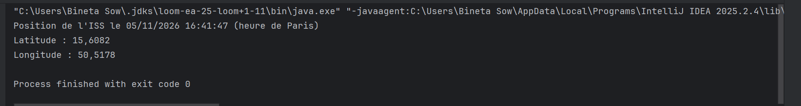

# Ciel du jour

Application Java en console qui affiche la position actuelle de la Station spatiale internationale (ISS).

## Aperçu

## Fonctionnalités

- Appel à l'API publique Open Notify pour récupérer la position de l'ISS
- Affichage de la latitude, de la longitude et de l'heure de Paris
- Gestion des erreurs : réseau coupé, délai dépassé, réponse invalide

## Technologies

- Java 21 et Maven
- Gson pour lire le JSON
- `java.net.http.HttpClient` pour les appels HTTP

## Lancer le projet

1. Installer un JDK 21 ou plus récent.
2. Cloner le dépôt : `git clone https://github.com/sow-bineta/ciel-du-jour.git`
3. Ouvrir le dossier dans IntelliJ IDEA, puis lancer la classe `app.Main`.

## Organisation du code

- `app` : le programme principal (`Main`)
- `client` : l'appel à l'API (`ClientIss`) et l'exception `ErreurApi`
- `modele` : la classe qui décrit la réponse de l'API (`ReponseIss`)

## Ce que j'ai appris

- Appeler une API web depuis Java et lire une réponse JSON
- Séparer le code en plusieurs classes selon leur rôle
- Gérer proprement les erreurs plutôt que de laisser le programme planter
- Utiliser Git et GitHub au quotidien

## Prochaines étapes

- Ajouter la photo astronomique du jour de la NASA
- Ajouter un menu pour choisir ce qu'on affiche